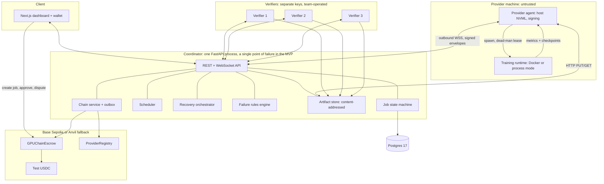
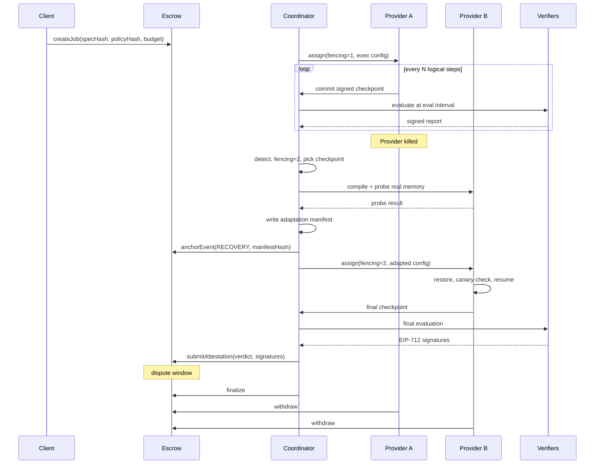
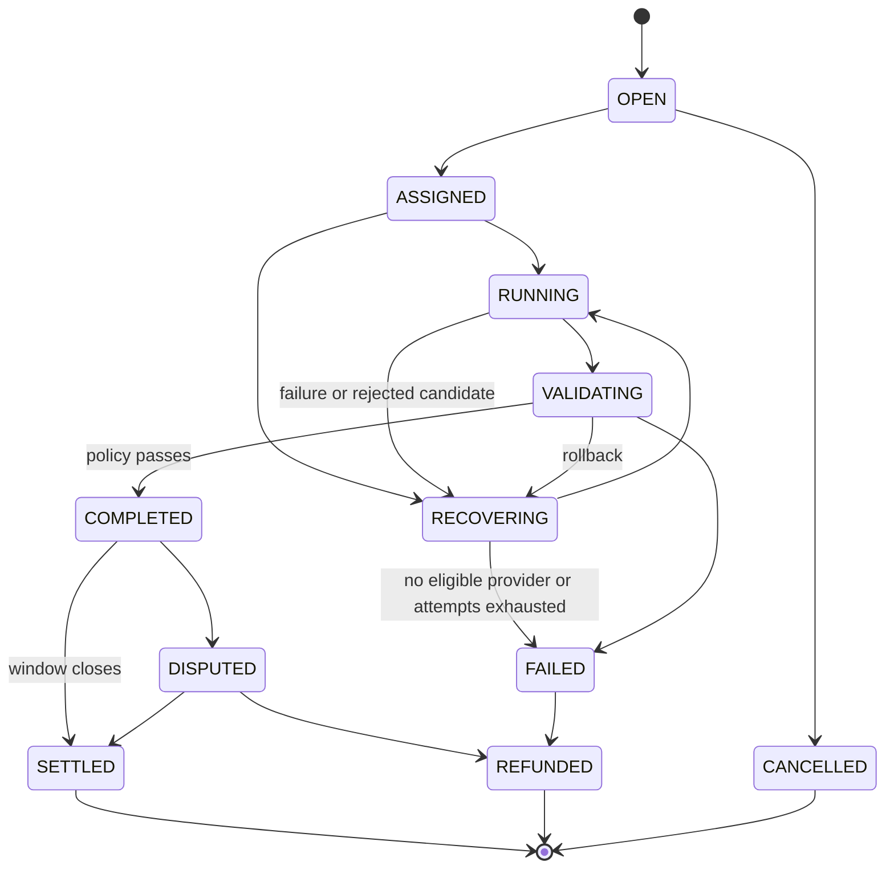
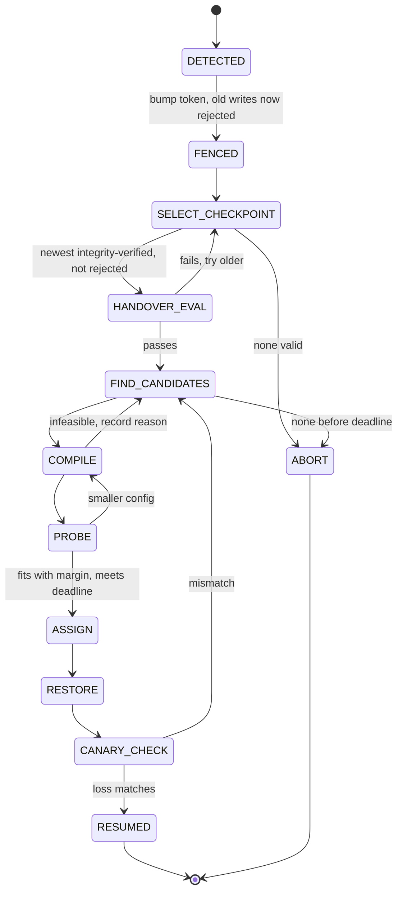
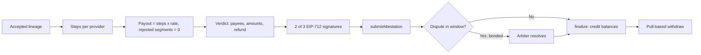

# GPUChain: Engineering Plan

**Team:** Piyush Garg (lead), Vaibhav Parmar, Arvind Kushwaha, Prateek Sharma
**Window:** Tue 3 Nov to Fri 13 Nov 2026 (10 days, not the 2-3 weeks in the brief)
**Internal deadlines:** feature freeze Mon 9 Nov, then debugging and testing Tue 10 and Wed 11, rehearsals Thu 12
**Choices made:** DistilBERT LoRA on AG News, free-tier second GPU, Base Sepolia, all work local with no GitHub or PRs for now

## Context

The repo is empty, so this is greenfield. We need a working prototype that recovers a training job across different GPUs, refuses bad results, and pays providers according to verified work. It must not pretend to be more decentralized or more verified than it is.

### What I measured on this laptop

| Fact | Value | Consequence |
|---|---|---|
| GPU | RTX 3060 Laptop, 6144 MiB, compute capability 8.6, driver 581.80 | BF16 is native. No H100, A100 or 4090 exists to demo on |
| RAM / CPU | 15.4 GB / Ryzen 9 5900HX, 16 threads | Docker is capped at about 8 GB. Dashboard must run as a production build |
| Free disk on C: | **about 24 GB** | A CUDA torch image is large. See risk R3 |
| Docker | 29.7.2, `nvidia` runtime registered | **Tested 3 Nov: `docker run --gpus all` sees the RTX 3060** (driver reports CUDA 13.0). Torch inside the container is still untested |
| Host NVML | Utilization, memory, temperature, power and clocks all work on Windows | The agent must read telemetry on the host |
| NVML in Docker | **Tested 3 Nov: `nvidia-smi` in a container reports utilization, temperature and power.** NVIDIA's WSL guide lists some of this as unsupported, and the `docker-desktop` distro itself has no `nvidia-smi` | Keep host-side telemetry as the default, because it is the documented path. Container readings are a usable backup |
| Local images | `python:3.12-slim`, `postgres:17-alpine` already present | Reuse them |
| Missing tools | Foundry, uv, psql, redis. System Python is 3.14 | Pin Python 3.12 in a venv |

---

## A. Executive Summary

**Technical:** GPUChain moves a training job between GPUs by saving portable, application-level state instead of a raw memory snapshot. An adaptation engine changes only how the job executes on the new GPU. An independent evaluator then checks the result with a statistical test before a multi-signer attestation releases payment, split by which provider's work survived into the accepted model.

**Business:** Developers on cheap or unreliable GPUs lose work when a host dies, and "completed" does not mean the model is good. GPUChain sells a guarantee: pay only for accepted results, and only to the providers who produced them.

### Where I am challenging the brief

| # | Brief says | Finding | What this plan does |
|---|---|---|---|
| 1 | Show H100 → RTX 4090 → T4 | We have none of those live, and a "simulated H100" running on a 3060 is misleading even if labelled | Name profiles by real capacity (6 GB, capped 3 GB, and so on), never by a GPU we don't have |
| 2 | "Predictive" Failure Engine | No training data exists. An ML predictor would be theatre | Build a rule-based early-warning engine and say so. ML prediction is P2 |
| 3 | Verify the training was correct | Heterogeneous recovery breaks bitwise determinism, which execution-verification systems such as Gensyn's Verde depend on (RepOps) | Verify **outcomes**, statistically. Never claim proof of correct execution |
| 4 | Protect datasets and weights from malicious providers | A provider can read plaintext in GPU memory without a TEE, and TEE attestation is documented for H100-class hardware, not our GPU | MVP uses public model and data only. Encryption at rest protects storage, and we say that's all it protects |
| 5 | 2 percentage point degradation limit | On SST-2's validation set (872 examples) the 95% CI is about ±2 points, so that test would be measuring noise | Use a larger frozen set and a paired non-inferiority test (section G) |
| 6 | Redis, Celery, Prometheus, Grafana, OpenTelemetry, MinIO | Each adds failure modes and memory with no demo benefit | Postgres plus one coordinator process |
| 7 | Accelerate and Trainer in the runtime | We need exact control and no pickle in checkpoints. Accelerate's optimizer saving appears to be pickle-based (confirm on Day 1) | A custom training loop of about 300 lines |
| 8 | Fine-grained job status on-chain | Costs gas and adds attack surface, and provides little value on-chain | Coarse states on-chain, plus hash-anchored recovery events |
| 9 | T4 on Colab free as a live provider | **Colab's FAQ restricts "running distributed computing workers" on free runtimes, and such runtimes may be terminated without warning** | T4 is an interactive notebook experiment with recorded evidence, not a connected worker |

### The better second GPU: your teammates' laptops

With four people working locally, **any teammate with a different NVIDIA GPU is a better second provider than Colab**. It is real, independent, allowed, and can run live over a hotspot. This is the first task today (see "Do today" in section H).

### Technically impossible or unjustifiably risky: dropped as claims

- Proving a recovered run equals an uninterrupted one
- Any GPU running any workload
- Trustless compute, or confidentiality against a malicious provider without a TEE
- Cryptographic proof of hardware on consumer GPUs (`nvidia-smi` output is self-reported)
- A decentralized verifier network (all our verifiers are team-operated)
- Secret evaluation data on a public dataset. AG News test data is public, so a provider could train on it. Production needs a client-private holdout

---

## B. Competitor and Novelty Report

**Evidence quality varies.** Vendor pages are claims, not independent results. "Not documented" means I didn't find it in what I read, not that it doesn't exist. Closed systems may do more.

### Competitive matrix

| Capability | Existing implementation | GPUChain proposal | Real differentiation |
|---|---|---|---|
| GPU marketplace | Akash, io.net, Nosana, Vast.ai, RunPod, Aethir, Lium: mature, far larger | A demo-scale network | **None. They are far ahead** |
| GPU scheduling | SkyPilot retries across infra. io.net moves to a healthy GPU in the same region | Expected-cost ranking using measured throughput | Small |
| Checkpoint recovery | Same-environment: Cedana, CRIUgpu, cuda-checkpoint. Microsoft Singularity migrates jobs across same-type accelerators. io.net resumes "if configured". SkyPilot and Vast leave checkpointing to the user | Automatic and portable, with signed lineage | Moderate |
| Heterogeneous adaptation | Composer halves microbatches on OOM (experimental). ElasWave keeps global batch size while reshaping microbatches. Universal Checkpointing resumes across parallelism layouts. AutoHet and Cephalo target heterogeneous clusters | Marketplace-triggered adaptation with a measured probe and a manifest | **The technique is not novel.** Applying it automatically to a marketplace failover is less common |
| Quality-constrained recovery | Not documented in any marketplace I reviewed | Paired statistical gate before payment | **Strongest gap. Medium confidence** |
| Failure prediction | io.net and Aethir health checks. Expanse (YC) predicts failures on clusters | Rules only | **None** |
| On-chain settlement | Akash escrow, Ocean (pay on success, retry elsewhere), Hyperway (escrow on verified completion) | k-of-n attestation, **payout split by accepted lineage** | Moderate. Split payout across a failover not found |
| Provider reputation | Lium and Compute Subnet validators score hardware. Akash uses auditors, and AEP-29 covers TEE attestation for H100/H200 | Passport that labels each claim by evidence level | Small to moderate |

**Other findings:**
- **Prime Intellect** (INTELLECT-1) achieved fault-tolerant training with live checkpoint recovery across 30 providers, a far harder system, but its report describes up to 112 H100s rather than mixed GPU models.
- **Verde** verifies execution, with stronger guarantees than ours, but needs bitwise identical outputs. It is complementary to our approach, not a competitor.
- **exaBITS** claims resume at the failure point in a press release, with no technical evidence I could check.
- **Expanse** is a YC cluster tool that diagnoses failures. It is not decentralized.
- **Nosana** documents replicas as a fallback. **Akash** documents manual close-and-redeploy, and provider-local storage is lost on switching.

### Research gaps

- **Render Network:** my search returned nothing relevant, so I make no claims about it.
- **Patents:** one search found only IBM's US11586932B2 (variable batch sizing with gradient checkpoint segments). This is **not** a freedom-to-operate result.
- **Hackathon projects:** TrainChain and Hyperway are closest. There may be others I didn't find.
- **Cedana cross-GPU:** its materials don't say. A third-party blog says CUDA checkpoint restore needs the same topology.

### Novelty assessment

| Claim | Status | Confidence |
|---|---|---|
| Resume training on a different GPU | **Not novel** | High |
| Preserve effective batch size with accumulation | **Not novel** | High |
| Gate payment on a pre-agreed statistical quality test after recovery | No marketplace example found | Medium |
| Split one job's payout across providers by accepted checkpoint lineage | No example found | Medium-low |
| The integrated pipeline | No example found | Medium-low |

**Answer to the core research question:** yes, for a narrow class of jobs: fixed architecture, no BatchNorm, FP32 master weights, allowlisted workload. We can resume across GPUs while keeping logical training state intact. Numerical results will differ, so we demonstrate **no detected degradation beyond a stated margin**, not equivalence.

**Defensible pitch line:** "We did not invent checkpointing or gradient accumulation. We bind them to a pre-agreed quality contract, so a provider's failure, or a bad result, has a defined and enforceable financial outcome."

---

## C. Architecture

### Component diagram



### Data flow: failure through settlement



### Job state diagram



**On-chain mapping:**

| Off-chain | On-chain |
|---|---|
| OPEN | `Funded` |
| ASSIGNED, RUNNING, RECOVERING, VALIDATING | `Active` (plus anchor events) |
| COMPLETED | `Attested` |
| SETTLED | `Settled` |
| DISPUTED | `Disputed` |
| FAILED, REFUNDED | `Refunded` |
| CANCELLED | `Cancelled` |

### Recovery state diagram



### Settlement flow



### Trust boundaries

| Boundary | Trusted for | Not trusted for | Stated limit |
|---|---|---|---|
| Client | Funding, choosing policy | Honest disputes (bond required) | |
| Coordinator | Scheduling, liveness | **Moving funds** without a verifier quorum | Single point of failure. Can censor or stall, but timeout refund protects funds |
| Provider | Nothing by default | Telemetry, hardware claims, checkpoints, results | Can read job data |
| Verifiers | Quality verdict, by k-of-n | Individually | **Team-operated: permissioned, not decentralized.** Collusion of k breaks it |
| Arbiter | Disputes | | Centralized in MVP. Disclosed in the demo |
| Contract | Rules as written | Any off-chain truth | Not audited, testnet only |

---

## D. Technical Decisions

Versions were checked on 3 Nov 2026 where a source is given. **Lock them in the Day 1 spike.**

| Area | Choice | Alternatives | Why | Tradeoff / concern |
|---|---|---|---|---|
| Language | Python 3.12 | System 3.14 | Safest for the ML stack, base image already local | Needs a venv |
| ML | torch 2.15.0, transformers 5.22.1, peft 0.21.2 | Older pins | Current on PyPI. Torch must be ≥ 2.6 because of CVE-2025-32434 | Transformers 5 may have API changes. Verify with the spike |
| CUDA build | A 13.x wheel | 12.x | Pre-release notices say 2.15 drops 12.6 wheels but keeps Turing (T4). **P100 is dropped**, so Kaggle's P100 option won't run these wheels | Those notices aren't a final matrix. A cu130 removal notice was also seen, so check the available index |
| Training loop | Custom | Trainer, Accelerate 1.15 | Controlled logical steps, no pickle | We own more code |
| Quantization | None | bitsandbytes | Not needed at this size. Quantized base can't change mid-job | P2 |
| Model | `distilbert-base-uncased`, LoRA + classifier head | SmolLM2 | Small checkpoints, no BatchNorm, per-example metric | Less flashy than an LLM |
| Dataset | AG News, `max_length` padding | Dynamic padding | Fixed length makes memory predictable, and avoids mean-of-means bugs | Slower. Pick length on Day 1 |
| Backend | FastAPI, SQLAlchemy 2, Alembic | Microservices | One process to run and debug | Single point of failure, disclosed |
| Database | Postgres 17 Alpine | SQLite | Row locks, already local | |
| Queue | Postgres outbox | Celery, Redis | Exactly the durability needed, with one fewer service | Lower throughput, irrelevant here |
| Artifacts | Content-addressed disk behind the coordinator | MinIO, S3 | Simplest, no extra service | Single machine |
| Metrics | Postgres + JSON logs | Prometheus, Grafana | Dashboard is the interface | P2 |
| Contracts | Solidity, Foundry v1.9.0, OpenZeppelin v5.7.0 | Hardhat | Fuzz and invariant testing | Foundry v1.9.0 was released on 2 Nov. Pin back a version if unstable |
| Chain | Base Sepolia (84532), RPC `sepolia.base.org` | Other testnets | Confirmed in Base docs | Public RPC limits not stated. Keep a second RPC |
| Token | Circle test USDC `0x036CbD53842c5426634e7929541eC2318f3dCF7e` | Mock only | Address confirmed in Circle docs | Faucet limited. Fund early. MockUSDC on Anvil |
| Chain client | web3.py (backend), viem + wagmi (web) | ethers | Match each language | |
| Frontend | Next.js, TypeScript, Tailwind | | As briefed. Run locally as a production build | Check Node version compatibility on Day 1 |
| Isolation | Docker with restrictive flags on the laptop, process mode on notebooks | gVisor | Colab can't run the Docker path, and its FAQ also restricts containerization used to get around its policies | Process mode has weak isolation, for team-run hosts only |

### Dropped from the brief, with reason

Redis, Celery, Prometheus, Grafana, OpenTelemetry and Kubernetes add services without improving recovery. Add them only if a real need appears.

---

## E. Database and API

### Schema

All tables have `id UUID PK` and `created_at`.

```text
users(display_name)
wallets(user_id FK, address UNIQUE, role[client|provider|verifier|arbiter])

providers(wallet_id FK, name, status, kind[REAL|CAPPED_PROFILE|INJECTED_FAULT],
          physical_gpu_id FK, price_per_step, enrolled_key, enrollment_sig)
gpu_hardware(uuid_hash, model, vram_mib, compute_cap, driver, native_bf16,
             evidence[CLAIMED|OBSERVED|MEASURED|VERIFIER_CHECKED])
workers(provider_id FK, session_pubkey, mode[docker|process], last_seen, state)
benchmarks(provider_id FK, runtime_hash, micro_batch, amp, steps_per_s, peak_mem_mib, nonce, sig)

jobs(client_wallet_id FK, onchain_id BYTES32 UNIQUE, spec JSONB, spec_hash, policy JSONB,
     policy_hash, budget, deadline, state, state_version, fencing_token BIGINT, attempt)
job_transitions(job_id FK, from_state, to_state, reason, actor, idempotency_key UNIQUE)
job_assignments(job_id FK, provider_id FK, attempt, fencing_token, state, UNIQUE(job_id, attempt))
training_runs(assignment_id FK, start_step, end_step, accepted_steps, status)

checkpoints(job_id FK, run_id FK, manifest_hash UNIQUE, parent_hash, logical_step, fencing_token,
            state[COMMITTED|VERIFIED|ACCEPTED|REJECTED], size_bytes, signer)
recovery_events(job_id FK, attempt, kind, detected_at, fenced_at, resumed_at,
                from_checkpoint FK, lost_steps, cause, injected BOOL)
adaptation_manifests(job_id FK, attempt, target_provider FK, manifest JSONB, manifest_hash,
                     verdict, reject_reason)
quality_evaluations(checkpoint_id FK, verifier_wallet_id, eval_version_hash, reference_ckpt FK,
                    metrics JSONB, correctness_hash, ci_lower, verdict, report_hash, sig)
verification_attestations(job_id FK, verdict_hash, signer, signature, UNIQUE(job_id, verdict_hash, signer))

escrow_refs(job_id FK, chain_id, contract, create_tx, state)
settlements(job_id FK, verdict JSONB, submit_tx, finalize_tx, status)
provider_reputation(provider_id FK, jobs_ok, jobs_failed, recoveries, rejected_candidates,
                    steps_accepted, beta_a, beta_b, passport_hash)

telemetry_samples(worker_id, job_id, ts, util, mem_used, temp_c, power_w, step, loss, steps_per_s, source)
fault_injections(job_id, kind, requested_by, applied_at, outcome)
outbox(kind, payload JSONB, key UNIQUE, status, attempts)
```

### Consistency rules

- **State changes** only through `UPDATE ... WHERE state = :expected AND state_version = :v`, recorded in `job_transitions`.
- **Idempotency:** all mutating calls take `Idempotency-Key`. Replays return the original result.
- **Fencing:** a commit with a stale token gets `409 STALE_FENCING_TOKEN`, and the agent then kills its runtime.
- **Chain writes** go through the outbox. Before retrying, read on-chain state, so a retry can't double-apply.
- **On coordinator restart**, rebuild in-flight state from Postgres.

### REST endpoints

| Method and path | Purpose |
|---|---|
| `POST /auth/challenge`, `POST /auth/verify` | Wallet signature login |
| `GET /providers`, `GET /providers/{id}/passport` | Provider grid and passport |
| `POST /providers/enroll` | Provider signs a delegation to its worker key |
| `POST /jobs`, `GET /jobs/{id}` | Create and read a job |
| `POST /jobs/{id}/activate` | Confirm funded on-chain, begin scheduling |
| `POST /jobs/{id}/cancel` | Cancel before start |
| `GET /jobs/{id}/timeline`, `/checkpoints`, `/evaluations`, `/manifests` | Dashboard data |
| `POST /jobs/{id}/candidates/preview` | Show compile decisions per provider |
| `PUT /artifacts/{sha256}`, `GET /artifacts/{sha256}` | Upload and download with a short-lived capability token |
| `POST /jobs/{id}/checkpoints` | Commit a manifest (fencing enforced) |
| `POST /verifier/tasks/claim`, `POST /verifier/evaluations` | Verifier work |
| `POST /jobs/{id}/attestations` | Submit a verifier signature |
| `POST /demo/faults` | Inject a fault. Disabled unless `DEMO_MODE=1` |

### Real-time channels

- `WS /ws/network`: `provider.updated`, `telemetry.sample`
- `WS /ws/jobs/{id}`: `job.state_changed`, `training.progress`, `checkpoint.committed|verified|accepted|rejected`, `failure.detected`, `recovery.step`, `compile.decision`, `quality.result`, `chain.tx`
- `WS /agent/ws`: signed envelopes, outbound from the agent, so it works through NAT

**Agent envelope:** `{v, job_id, attempt, fencing_token, seq, ts, type, payload, sig}`. `seq` must increase per attempt, and duplicates are dropped.

**Heartbeat (starting values, tune on Day 4):** sent every 2 s, suspect after 3 misses, failed after 5.

### Example: create a job

```jsonc
// POST /jobs   Idempotency-Key: 9c1f...
{
  "workload": {
    "template": "distilbert-lora-agnews/v1",
    "model_revision": "<pinned HF commit>",
    "logical_batch_size": 32,
    "total_logical_steps": 300,
    "learning_rate": 0.0005,
    "seed": 1337
  },
  "policy": {
    "metric": "accuracy",
    "min_absolute": 0.88,
    "non_inferiority_margin": 0.02,
    "confidence": 0.95,
    "eval_set_hash": "<sha256>",
    "eval_version_hash": "<sha256>"
  },
  "budget_usdc": "5.00",
  "deadline_seconds": 1800
}
// 201 (values illustrative)
{
  "job_id": "...",
  "onchain_id": "0xab...",
  "state": "OPEN",
  "spec_hash": "0x...",
  "policy_hash": "0x...",
  "next": {"action": "createJob", "contract": "0x..."}
}
```

### Example: commit a checkpoint

```jsonc
// POST /jobs/{id}/checkpoints
{ "manifest": { /* GPCK manifest, section G */ }, "manifest_sig": "0x..." , "fencing_token": 2 }
// 201
{ "checkpoint_id": "...", "state": "COMMITTED", "manifest_hash": "..." }
// 409
{ "error": "STALE_FENCING_TOKEN", "current": 3 }
```

### Example: inject a fault

```jsonc
// POST /demo/faults
{ "job_id": "...", "kind": "KILL_CONTAINER" }
// 202
{ "fault_id": "...", "applied_at": null, "label": "INJECTED" }
```

---

## F. Smart Contracts

### Two contracts, not five

- **`GPUChainEscrow`**: holds funds, enforces the job lifecycle, verifies attestations. Not upgradeable.
- **`ProviderRegistry`**: provider address, metadata hash, passport root. Holds no funds, so bugs here can't drain money.
- **No reputation contract.** Reputation is derived from events and passports. **No token.** Anvil adds `MockUSDC`.

### Interface

```solidity
enum State { None, Funded, Active, Attested, Disputed, Settled, Refunded, Cancelled }

struct Verdict {            // EIP-712 typed data
  bytes32 jobId;
  bool passed;
  bytes32 finalCheckpoint;
  bytes32 lineageRoot;
  bytes32 qualityReport;
  address[] payees;         // at most 8
  uint256[] amounts;
  uint256 refund;           // sum(amounts) + refund == budget
  uint64 expiry;
}

function createJob(bytes32 jobId, bytes32 specHash, bytes32 policyHash,
                   uint256 budget, uint64 deadline, uint64 disputeWindow) external;
function cancel(bytes32 jobId) external;              // client, only while Funded
function markActive(bytes32 jobId) external;          // coordinator
function anchorEvent(bytes32 jobId, uint8 kind, uint32 attempt, bytes32 dataHash) external; // coordinator, event only
function submitAttestation(Verdict calldata v, bytes[] calldata sigs) external;  // anyone; signers strictly ascending
function finalize(bytes32 jobId) external;            // anyone, after the window
function dispute(bytes32 jobId) external;             // client, in window, posts a bond
function resolveDispute(bytes32 jobId, uint256[] calldata amounts, uint256 refund) external; // arbiter
function claimTimeoutRefund(bytes32 jobId) external;  // anyone, after deadline + grace
function withdraw() external;                         // pull payment

event JobCreated(bytes32 indexed jobId, address indexed client, uint256 budget, bytes32 specHash, bytes32 policyHash);
event JobActivated(bytes32 indexed jobId);
event JobAnchor(bytes32 indexed jobId, uint8 indexed kind, uint32 attempt, bytes32 dataHash);
event JobAttested(bytes32 indexed jobId, bool passed, bytes32 finalCheckpoint, uint64 disputeEnd);
event JobDisputed(bytes32 indexed jobId);
event JobSettled(bytes32 indexed jobId, uint256 paid, uint256 refunded);
event JobRefunded(bytes32 indexed jobId, uint256 amount);
event Withdrawal(address indexed account, uint256 amount);
```

### Payment rules

- `payout = accepted_steps x provider_rate`, capped by the budget, with the remainder refunded to the client.
- Rejected segments and unsaved steps earn nothing, so providers have a reason to checkpoint honestly.
- A failed job refunds in full (`passed=false`, no payees). **Known harshness:** an honest early provider goes unpaid if a later failure kills the job. Partial payment on failure is P1.

### The trust model questions from the brief

| Question | Answer |
|---|---|
| Who signs execution receipts? | The provider's enrolled worker key signs each checkpoint manifest. The lineage root commits to all of them |
| Who evaluates quality? | Independent verifier processes with separate keys |
| How many signatures? | 2 of 3 for the MVP. The verifier set version is snapshotted per job, so it can't change mid-job |
| How can a user dispute? | `dispute()` inside the window with a bond, decided by the arbiter |
| Provider disappears? | Recovery runs. If none succeeds, the job fails and the client is refunded. `claimTimeoutRefund` works even if the coordinator is dead |
| Verifiers collude? | They could approve a bad result. Mitigations are the dispute window and public report hashes. **There is no cryptographic defence in the MVP** |
| Arbiter silent? | After a timeout the verdict stands and the bond is returned. Collusion plus a silent arbiter costs the client. Disclosed |

### Contract threat analysis

| Attack | Mitigation | Test |
|---|---|---|
| Reentrancy | Checks-effects-interactions, `ReentrancyGuard`, pull payments, immutable token | Malicious token mock |
| Replay across chains or contracts | EIP-712 domain includes chain ID and contract, `jobId` bound, one-shot state, expiry | Replay tests |
| Duplicate or malleable signatures | OpenZeppelin ECDSA, strictly ascending signer order | Fuzz |
| Bad payout math | `sum(amounts) + refund == budget` enforced | Invariant: contract balance = total locked + total withdrawable |
| Non-verifier signature | Must be in the job's verifier set | Unit test |
| Coordinator overreach | Can only anchor events and mark active, can't move funds | Access tests |
| Gas denial of service | Max 8 payees, pull payment | Limit test |
| Griefing disputes | Bond, forfeited if rejected | Unit test |
| Permanent lock | Timeout refund is permissionless | Time-warp test |
| USDC approval race | Exact approve per job | Integration test |

Run Slither before deployment if time allows. **This contract is unaudited and must not hold real funds.**

### Wider threat model

| Attack | Mitigation | Remaining limit |
|---|---|---|
| Provider lies about GPU | Measured benchmark labelled by evidence level | No proof on consumer GPUs |
| Provider fakes telemetry | Telemetry never affects payment | Can mislead the dashboard |
| Provider poisons weights | Quality Guard rejects it, rollback, no pay | Small, subtle damage below the margin can pass |
| Provider skips training | Weight-change check, final absolute floor | A copied model can pass. Random re-execution audit is P1 |
| Provider trains on public eval data | Disclosed | Needs a client-private holdout |
| Malicious checkpoint | Safetensors + JSON only, shape allowlist, NaN/Inf check. **`torch.load` never used** | Parser bugs remain possible |
| Zombie worker | Fencing token, dead-man lease | |
| Provider steals data | Public data only | Requires TEE |
| Job escapes to host | Allowlisted templates only (no user code), `--network none`, `--cap-drop ALL`, `no-new-privileges`, read-only root, non-root, memory, CPU and PID limits | Containers share a kernel and driver surface |
| Agent impersonation | Wallet-signed delegation, signed envelopes, sequence numbers | |
| Colluding verifiers | See above | Inherent to the MVP |

---

## G. Module-by-Module Implementation Plan

### Repository structure (improved from the brief)

```text
gpuchain/
├── apps/
│   ├── coordinator/        FastAPI: api, jobs, scheduler, recovery, rules, artifacts, chain
│   └── web/                Next.js dashboard
├── workers/
│   ├── agent/              Provider agent: NVML, spawning, signing, faults
│   ├── runtime/            Training runtime: no coordinator dependency
│   └── verifier/           Evaluation + signing
├── packages/
│   ├── gpuchain_core/      Pure Python: schemas, canonical JSON, signing, GPCK, compiler logic, stats
│   └── shared-types/       TypeScript generated from OpenAPI
├── contracts/              Foundry: src, test, script
├── infra/                  compose, Dockerfiles, T4 notebook, preflight script
├── experiments/            Spikes, benchmark harness, raw JSON results
├── tests/                  e2e and fault scenarios
└── docs/                   Decisions, threat model, schemas, demo runbook
```

Changes from the brief: `core/` becomes one tested library, because agent, runtime, verifier and coordinator all need the same code. `datasets/` is removed: we keep a fetch script and fingerprints, not data files.

### Core design: the logical-step invariant

**A logical step means the same thing on every GPU.** This is the heart of the system.

```text
Immutable for the whole job:   model + revision, LoRA config, optimizer + hyperparameters,
                               LR schedule, logical batch size L, max length, seed,
                               dataset fingerprint, loss
Adaptable per GPU:             micro-batch m (m divides L), accumulation a = L/m,
                               autocast mode, gradient checkpointing, attention impl, loader workers
```

| Problem | Design |
|---|---|
| Data position | Example order comes from `f(seed, epoch)`, so no sampler state is saved. Every logical step uses the same examples at any micro-batch size |
| Random state | CUDA RNG state isn't portable. Each micro-batch reseeds from `hash(seed, step, micro_index)`. Dropout masks still differ when micro-batching changes, and we report that rather than hide it |
| Gradient scale | `loss = mean_loss * (n_micro / L)`, which is correct even for unequal micro-batches. Clip only after accumulation |
| Learning rate | A pure function of the logical step, so there's no scheduler state to corrupt |
| Precision | Master weights and optimizer state stay **FP32 always**. Only autocast changes, so switching needs no tensor conversion |
| GradScaler | FP16 only. Moving FP16→BF16 discards it, and BF16→FP16 starts fresh. Both are recorded in the manifest |
| BF16 check | **Never `torch.cuda.is_bf16_supported()` alone**, because it returns True via emulation on T4. Require compute capability ≥ 8 |
| Device moves | Load to CPU, validate, then move model and optimizer tensors to the device |
| Optimizer mapping | State is keyed by parameter **name**, not index |
| BatchNorm | DistilBERT has none. The compiler rejects any workload containing it |

### Checkpoint format: GPCK v1

```text
<checkpoint>/
├── trainable.safetensors   LoRA + classifier head only (base model is pinned and hash-checked)
├── optimizer.safetensors   Adam moments + step, keyed by parameter name
└── manifest.json           Canonical JSON (RFC 8785), signed
```

```jsonc
{
  "format": "GPCK/1",
  "job_id": "...", "attempt": 2, "fencing_token": 2,
  "logical_step": 100, "epoch": 0,
  "immutable_hash": "...",
  "model": {"id": "distilbert-base-uncased", "revision": "...", "base_sha256": "...", "tokenizer_sha256": "..."},
  "dataset_fingerprint": "...",
  "exec": {"micro_batch": 8, "accum": 4, "amp": "bf16", "grad_ckpt": false},
  "scaler": null,
  "canary": {"loss_fp32": 0.4213},
  "environment": {"gpu": "...", "driver": "...", "torch": "...", "image_digest": "..."},
  "files": {"trainable.safetensors": {"sha256": "...", "bytes": 0}},
  "parent_manifest_hash": "...",
  "adaptation_manifest_hash": "...",
  "signer": "0x...", "signature": "0x..."
}
```

**Lifecycle:** at an optimizer-step boundary only: copy tensors to CPU → write temp files → fsync → hash → upload by hash → commit manifest (**commit is the atomic point**).
A crash at any earlier point leaves an unreferenced blob, which garbage collection removes. Upload happens in the background so training continues.

**States:** `COMMITTED → VERIFIED (integrity + load check) → ACCEPTED or REJECTED (quality)`

**Load validation:** signature → fencing → parent chain → hashes → size cap → tensor names, shapes and dtypes against an allowlist → no NaN/Inf.

**Canary check:** after restore, compute FP32 loss on a fixed batch and compare with the value in the manifest. This catches a broken restore before any compute is wasted.

**Encryption:** AES-256-GCM at rest is P1, and only protects stored artifacts.

### Elastic GPU Compiler pipeline

1. **Inspect workload:** load immutable spec, reject unsupported layers.
2. **Inspect source:** read current config from the last checkpoint.
3. **Requirements:** use last run's measured peak memory for ordering only. **Estimates never approve a config.**
4. **Hard gates on target:** CUDA, compute capability against the torch build, free memory floor, torch version.
5. **Candidate configs**, in order: keep AMP if native, else FP16. Largest micro-batch first, gradient checkpointing only if needed.
6. **Measured probe on the real target:** full forward, backward and optimizer step at max length. Pass requires peak ≤ 85% of capacity (starting value).
7. **Deadline and budget check** using probe throughput.
8. **Write the manifest:** every change and why, or every rejection reason.
9. **Restore and canary check.**
10. **Resume,** then verify the next checkpoint's lineage.

```jsonc
// Adaptation manifest (values illustrative, real ones come from probes)
{
  "from": {"provider": "A", "micro_batch": 32, "accum": 1, "amp": "bf16"},
  "to":   {"provider": "B", "micro_batch": 8,  "accum": 4, "amp": "bf16"},
  "invariants": {"logical_batch": 32, "lr_schedule_hash": "...", "immutable_hash": "..."},
  "changes": [{"field": "micro_batch", "from": 32, "to": 8, "reason": "probe OOM at 32 and 16 under 3072 MiB cap"}],
  "rejected_candidates": [{"provider": "C", "reason": "OOM at micro_batch=1 under cap"}],
  "probe": {"peak_mem_mib": 0, "steps_per_s": 0, "duration_s": 0}
}
```

Prior art to credit: Composer's OOM halving, ElasWave's fixed global batch.

### Scheduler: no invented weights

**Hard constraints first:** compile succeeds, online, not excluded, deadline and budget can be met.

**Then rank by expected cost to finish:**

```text
p_fail   = (failures + 1) / (jobs + 2)                 Laplace prior, shown as "new" with few jobs
T_rem    = remaining_steps / measured_steps_per_s
E[cost]  = rate x remaining_steps / (1 - p_fail)
```

Lowest `E[cost]` wins, with memory headroom as the tie-break. Every number is measured or a declared price, and the UI shows the calculation.

Rules are simple, explainable, and easy to replace if evidence shows they're wrong.

### Failure rules engine

| Signal | Source | Action |
|---|---|---|
| Runtime exits or OOM | Agent, immediate | Recovery |
| Missed heartbeats | Coordinator | Suspect, then recovery |
| Temperature or memory pressure above threshold | Host NVML | Warning + emergency checkpoint |
| Throughput collapse | Runtime | Warning + emergency checkpoint |
| Checkpoint commits overdue | Coordinator | Warning |
| Failure history | Reputation table | Scheduler input only |

**Dead-man lease:** the runtime exits if the agent stops renewing its lease. This matters more than it looks. Two profiles share one physical GPU, so **a zombie process would hold VRAM and make the replacement OOM for the wrong reason**. An agent restart also reaps orphans.

### Quality Guard

| Item | Design |
|---|---|
| Fixed data | AG News test split, stratified subset, hash pinned in policy. Never sent to providers |
| Evaluation version | Hash of code, image, tokenizer and data |
| Eval mode | FP32, no autocast, no dropout, fixed order |
| Reference | The last ACCEPTED checkpoint. At job start, the untrained baseline |
| Test | Paired bootstrap on per-example correctness (2000 resamples, seeded from job + checkpoint hash). Pass if the one-sided 95% lower bound of `acc_candidate - acc_reference` ≥ `-margin` |
| Absolute floor | Final candidate only, because early checkpoints can't meet it |
| Extra checks | Weight-change check, no NaN/Inf, signature and lineage. McNemar reported alongside, not used for the decision |
| Quorum | k verifiers must agree on verdict for the same checkpoint hash. Their reports need not be identical across devices |
| Rollback | Mark rejected, fence, zero pay for that segment, resume from the last accepted |
| Other metrics | Macro-F1 reported. Perplexity is P1 with the LLM workload. **The policy is fixed before execution** |

**Why a large set matters.** 95% half-width at 90% accuracy, unpaired (calculated):

| n | Half-width |
|---|---|
| 872 (SST-2 validation) | ±2.0 pts |
| 2,000 | ±1.3 pts |
| 7,600 (full AG News test) | ±0.7 pts |

Paired tests are tighter. Use the full set if Day 2 timing allows, otherwise a stratified subset of at least 2,000.

**Open question to test on Day 2:** normal training can dip between checkpoints, so the margin must be set from measured fluctuation or honest jobs will get rejected.

### GPU Passport

Off-chain JSON, hash anchored in `ProviderRegistry`. **Every field has an evidence label:**

| Level | Meaning | Example |
|---|---|---|
| `CLAIMED` | Provider says so | Listed spec |
| `OBSERVED` | The provider's own agent read it | NVML output |
| `MEASURED` | Nonce-challenged benchmark, signed by the provider | Steps/s. Still provider-run |
| `VERIFIER_CHECKED` | Derived from accepted results | Accepted steps, rejections |
| `ATTESTED` | Hardware attestation | **Not available on our hardware.** NVIDIA documents this for H100+ in CC mode, and its Python SDK is deprecated in favour of C++/CLI. P2 |

### Files, responsibilities and tests by owner

**Tracks are by area. I don't know each person's strengths, so Piyush should swap as needed.**

#### Vaibhav Parmar: ML runtime and compiler

| Path | Responsibility | Tests |
|---|---|---|
| `experiments/spike_*` | Day 1-2 feasibility | Writes the Go/No-Go table |
| `workers/runtime/trainer.py` | Loop, logical steps, seeds, autocast | Gradient invariance |
| `workers/runtime/data.py` | Stateless batches | Same examples for any m |
| `gpuchain_core/gpck.py` | Save, load, validate | Round trip, malicious files |
| `gpuchain_core/compiler.py`, `workers/runtime/probe.py` | Candidates, probe | Rejection, cap enforcement |
| `workers/runtime/synthetic.py` | Fast deterministic CPU workload | Used by everyone's tests |
| `infra/t4_notebook.ipynb` | Interactive T4 evidence run | Cross-GPU resume |
| `experiments/bench/` | Benchmark harness, raw JSON | Reproducible from one command |

#### Piyush Garg (lead): coordinator and integration

| Path | Responsibility | Tests |
|---|---|---|
| `docs/schemas/` | Freeze all shared schemas on Day 1 | Schema tests |
| `apps/coordinator/models.py`, `migrations/` | Database | Migration test |
| `apps/coordinator/jobs.py` | State machine, idempotency | Illegal transitions, replays |
| `apps/coordinator/agent_gateway.py` | WSS, envelopes, heartbeats | Forged, replayed, stale |
| `workers/agent/` | NVML, enrollment, Docker/process spawn, lease, fault hooks | Orphan cleanup, restart, each fault detected correctly |
| `apps/coordinator/recovery.py` | Recovery orchestrator | Every failure branch |
| `apps/coordinator/scheduler.py` | Hard gates, ranking | Deterministic ranking |
| `apps/coordinator/artifacts.py` | Content-addressed storage | Hash mismatch, partial upload |
| `gpuchain_core/signing.py` | Canonical JSON, signatures | Cross-checks with Solidity vectors |

Also: daily integration and Go/No-Go decisions. **Piyush has the heaviest load.** If it slips, `artifacts.py` moves to Arvind.

#### Arvind Kushwaha: contracts and verification

| Path | Responsibility | Tests |
|---|---|---|
| `contracts/src/GPUChainEscrow.sol`, `ProviderRegistry.sol` | Contracts | Unit, fuzz, invariant |
| `contracts/script/Deploy.s.sol` | Anvil and Base Sepolia | Deploy rehearsal |
| `apps/coordinator/chain.py` | Outbox, nonces, retries, reconciliation | Double-submit, RPC failure |
| `gpuchain_core/quality.py` | Bootstrap, policy | Known-answer tests |
| `workers/verifier/` | Evaluation, signed reports, EIP-712 | Device agreement, Solidity recovery |

#### Prateek Sharma: UI/UX, dashboard and demo

| Path | Responsibility | Tests |
|---|---|---|
| `apps/web/` | Design system, all screens, charts, wallet | Render from recorded events, every state covered |
| `apps/web/replay/` | Plays recorded events into the UI, so UI work never waits on the backend | Used for UI tests and as a demo fallback |
| Fault controls in UI | Buttons that call `POST /demo/faults` | Each button triggers its fault |
| `docs/demo-runbook.md`, `infra/preflight.*` | Runbook, video, pitch | Rehearsals |

### UI/UX plan

**Goal:** a judge understands what just happened within 5 seconds of looking, from across a room.

**Direction:** a calm control-room look, dark theme by default for projectors, with color reserved for meaning. Choose the visual direction on Day 1 and use it everywhere. Avoid a generic crypto-dashboard template.

**Screens, in priority order:**

| Screen | Purpose | Must show |
|---|---|---|
| **1. Mission control (the demo screen)** | One page tells the whole story | Provider grid, live loss and telemetry, recovery timeline, current stage in plain words |
| 2. Recovery detail | Why the system chose what it chose | Compile table with accepted and rejected providers, reasons, before and after config |
| 3. Quality result | Why a candidate passed or failed | Candidate vs reference, confidence interval against the margin, plain-language verdict |
| 4. Settlement | Who got paid and why | Payout split by accepted steps, zero for rejected work, explorer links |
| 5. New job | Submit a job | Short form with sane defaults, policy explained, wallet flow with clear steps |
| 6. Provider passport (P1) | Provider history | Every field labelled by evidence level |

**UX rules:**

- **One clear primary action per screen.** The Kill button is obvious, and asks for a quick second press to prevent accidents.
- **Plain language first, details on demand.** "Provider A stopped responding" comes first, with the raw event one click away.
- **Every state is designed:** loading, empty, waiting on chain, offline, error, and reconnecting. A stuck spinner never appears: pending chain transactions show their status and link.
- **Motion follows real events only.** The recovery animation moves when an event arrives, never on a timer.
- **Truth badges are part of the design,** not small print: REAL, CAPPED PROFILE, INJECTED FAULT, RECORDED, LOCAL CHAIN.
- **Readable on a projector:** large type, strong contrast, status never conveyed by color alone, works at 1080p and on a laptop screen, keyboard reachable.
- **Numbers carry units and source,** and unknown values show as unknown, never as 0.

**Usability check on Tue 10:** someone outside the team watches a run without explanation, then says what happened. Fix whatever they get wrong.

### Working locally with no GitHub or PRs

- **Run `git init` locally.** Git is still useful without a remote: history and rollback are the safety net. I will not push, open PRs or commit unless you ask.
- **Canonical repo lives with Piyush.** Each person has their own clone.
- **Sync with `git bundle`** over a shared folder or USB: no server needed. Everyone sends their bundle by evening, and Piyush merges and returns one. A LAN bare repo is fine too, if someone prefers it.
- **Ownership prevents conflicts:** each person edits only their own directories above. Changes to `docs/schemas/` or `gpuchain_core/signing.py` go through Piyush.
- **Schemas freeze on Day 1,** so all four can build against mocks in parallel.
- **Secrets:** testnet keys stay in an untracked `.env`. Keep them out of bundles. Testnet-only wallets, never real funds.

---

## H. Roadmap: 10 Days

### Do today

1. **Everyone runs:** `nvidia-smi --query-gpu=name,memory.total,compute_cap,driver_version --format=csv`. A different NVIDIA GPU changes the demo for the better.
2. **Check disk** on the demo laptop. It needs at least 15 GB free for images and caches.
3. **Piyush confirms** the owner tracks.
4. **Check Kaggle's terms and quota directly.** I couldn't confirm them, and sources disagree.

### Schedule

> **Update, 3 Nov: the team starts building on Wed 4 Nov.** Do the Tue 3 and Wed 4 rows together on Wed 4, and keep gate G1 on Wed night. Pre-freeze budget drops from 28 to about 24 person-days, so Piyush should decide on Wed whether to apply cut-list items 1 and 2 from the start. The freeze stays on Mon 9.

| Day | Piyush | Vaibhav | Arvind | Prateek | Gate |
|---|---|---|---|---|---|
| **Tue 3 Nov** | Repo, schemas, compose | Spike: GPU in Docker, versions | Foundry setup, faucets | GPU inventory, design direction, UI skeleton | |
| **Wed 4** | DB, jobs API | Spike: step rate, VRAM, accuracy, T4 | Escrow core + tests | Component kit, event replay tool | **G1: feasibility** |
| **Thu 5** | Agent gateway + agent: NVML, spawn, lease | Trainer + invariance test, GPCK | Attestation + invariant tests | Mission-control screen on recorded events | |
| **Fri 6** | Artifacts, fencing, same-config recovery | Resume + canary | Bootstrap stats, verifier | Provider grid, recovery timeline | **G2: walking skeleton** |
| **Sat 7** | Adapted recovery, scheduler | Compiler + probe | Anvil deploy, chain service | Connect live WebSocket, job form + wallet | |
| **Sun 8** | Rollback, settlement path | Compiler integration, T4 run | Verifier quorum, rollback | Compile, quality and chain views | **G3: full E2E on Anvil** |
| **Mon 9** | Integration | Fault tests, tune caps | **Base Sepolia deploy**, reconciliation | Empty, loading and error states, truth badges, preflight | **G4: feature freeze** |
| **Tue 10** | **Debug day:** triage, fix integration bugs | **Debug:** run the fault matrix, fix | **Debug:** testnet E2E, fix | **UX test** with an outsider, fix findings | |
| **Wed 11** | Fix bugs, soak test | Benchmarks + 5-seed comparison (overnight too) | Security pass, fallback switch | Visual polish, **record video** | |
| **Thu 12** | Rehearsals, last fixes only | Rehearsals | Rehearsals | Rehearsals, pitch | **G5: 10 clean runs** |
| **Fri 13** | **Demo** | | | | |

### Time protected for debugging and testing

- **Feature work stops Mon 9 at night.** That leaves Tue, Wed and Thu (about 12 person-days) for debugging, testing and rehearsal.
- **Tests ship with the code.** A module isn't done until its tests in section G pass.
- **Daily rhythm:** a 10-minute standup, evening merge by Piyush, then run the E2E on the merged code. A broken merge gets fixed first, the next morning at the latest.
- **After the freeze:** only bug fixes, test fixes and UI polish that can't affect logic.
- **Bug priority:** P0 breaks the demo story, fix now. P1 visibly wrong, fix today. P2 goes on a list and probably doesn't get fixed.

### Gates and what happens if one fails

| Gate | Must be true | If not |
|---|---|---|
| **G1, Wed 4 night** | GPU in Docker works, training is fast enough, accuracy reaches a usable level, memory cap causes a real OOM | Docker fails → process mode on the laptop. Too slow → shorter job. Accuracy low → unfreeze a little more or raise steps |
| **G2, Fri 6 night** | Kill a worker, and job resumes from a checkpoint, without chain or dashboard | **All hands on recovery. Cut P1 entirely** |
| **G3, Sun 8 night** | Full flow runs on Anvil with visible dashboard | Apply the cut list below |
| **G4, Mon 9 night** | Testnet flow works. **No new features after this** | Demo on Anvil, testnet shown as recorded |
| **G5, Thu 12 night** | 10 consecutive clean runs | Use a simpler scenario, with video ready |

### Cut list if behind, in this order

The feature budget is now tight, so these are decided in advance:

1. All P1 except cross-GPU evidence
2. Scheduler ranking: use a fixed order, and show that honestly
3. Provider passport page
4. Handover evaluation: evaluate at final and on suspicion only
5. On-chain anchor events: keep attestation and settlement only
6. Third verifier: 2-of-2, disclosed

**Never cut:** recovery, Quality Guard rejection, settlement, truth badges, debug days.

### Critical path

```text
Spike → gradient invariance → GPCK resume → agent + heartbeats → recovery → compiler probe
  → Quality Guard → attestation → settlement → dashboard → rehearsal
```

**Parallel after Day 1 schemas:** contracts, agent, dashboard (from recorded events), statistics.

### Phases mapped to the brief

Compressed from the brief's phases. Effort is a rough estimate in person-days. Feature work before the freeze has a budget of about 28 of the 28 available (7 days x 4 people), **so there is no slack before the freeze: this is why the cut list exists.** The 12 person-days after it are reserved for debugging, testing and rehearsal.

| Phase | Objective | Key tasks | Prerequisites | Modules | Output and acceptance | Key tests | Blockers | Effort | Days |
|---|---|---|---|---|---|---|---|---|---|
| **0 Research** | Prove feasibility | Measure speed, VRAM, accuracy, T4 run | This plan | `experiments/` | Filled Go/No-Go table | Spike scripts | Disk, Docker GPU | 2 | 3-4 |
| **1 Foundation** | Shared base | Repo, schemas, DB, compose | Phase 0 started | `docs/schemas`, `infra`, `coordinator` | Clean start with one command | Migrations | Schema churn | 1.5 | 3-4 |
| **2 GPU infrastructure** | Real work on a real GPU | Enrollment, benchmark, spawn, job submit | 1 | `agent`, `runtime`, `scheduler` | Job trains, telemetry visible | Forged agent | NVML, Docker flags | 4 | 4-5 |
| **3 Checkpoint + recovery** | Survive a kill | GPCK, fencing, faults, restore | 2 | `gpck`, `recovery`, `artifacts` | Kill → auto-resume | Corrupt files, zombie | Lease edge cases | 6 | 5-6 |
| **4 Compiler** | Adapt to a new GPU | Gates, probe, manifest | 3 | `compiler`, `probe` | Capped provider completes | Invariance, reject | Memory cap behaviour | 3 | 7-8 |
| **5 Quality Guard** | Refuse bad results | Eval, bootstrap, rollback, signing | 3 | `quality`, `verifier` | Pass and reject both shown | Known-answer stats | Margin tuning | 3 | 6-8 |
| **6 Blockchain** | Enforce payment | Contracts, tests, deploy, reconciliation | Schemas | `contracts`, `chain` | Base Sepolia settlement | Fuzz, invariants | Faucet, RPC | 4 | 3-9 |
| **7 Dashboard + UX** | Clear, honest real-time UI | Design system, screens, states, replay, tx links | Event schema | `apps/web` | All data from real events, all states designed | Replay recording, outsider test | Scope creep | 5 | 3-9 |
| **8 Debugging, testing, demo** | Reliability | Debug days, fault matrix, bench, E2E, video, pitch | All | `tests`, `experiments`, `docs` | 10 clean runs | Whole matrix | Time | 12 reserved | 10-12 |

---

## I. Testing Strategy

**Unit:** logical-step math, compiler choices, statistics, state machine, canonical JSON.

**Correctness tests that matter most:**

| Test | Pass condition (target) |
|---|---|
| Gradient invariance: m in {1, 2, 4, 8}, CPU, FP64, no dropout | Max relative gradient difference ≤ 1e-9 |
| Same check in FP32 | ≤ 1e-4 |
| Round trip: save, reload, one step, compare to no-save run on same setup | Weights match within tolerance |
| Data invariance | Same example IDs per logical step, for all m |
| Precision switch BF16→FP16 | State stays FP32, scaler recorded, Guard decides the result |

**Security:** malformed safetensors, oversized files, wrong shapes, NaN, a pickle renamed as a checkpoint, forged signatures, replayed envelopes, stale fencing.

**Contracts:** see section F, including fuzz and invariants.

**E2E:** the full flow on Anvil with the synthetic workload, repeatable in CI-style local runs, with no GPU needed.

### Benchmark matrix

**All numbers come from `experiments/bench`, and raw JSON is kept. None exist yet, and none will be invented.**

| ID | Scenario | Method | Expected |
|---|---|---|---|
| S1 | Uninterrupted control | N seeds | Baseline |
| S2 | Kill, same GPU, same config | Kill at fixed step | Resume, compare to S1 |
| S3 | Cross-GPU: 3060 → T4 or teammate GPU | Real second GPU | BF16→FP16 if T4 |
| S4 | Adapted micro-batch and accumulation | Memory cap | Resume, compare to S1 |
| S5 | Incompatible hardware | Cap below minimum | Rejected with reason |
| S6 | Corrupted checkpoint | Flip bytes | Refused, falls back to older |
| S7 | Malicious or invalid provider | Forged manifest, poison | Refused or rejected, no pay |
| S8 | Quality Guard rejection | Poison, LR tamper, no-op | Rejected and rolled back |
| S9 | Failure during checkpoint write | Kill mid-write and mid-upload | Previous checkpoint used |

**Measured:** recovery time (injection → first resumed optimizer step, broken down by stage), lost steps, checkpoint overhead, throughput, GPU utilization and memory, success rate over N trials, quality difference with CI, cost difference, scheduler decision time.

**Reporting rule:** with 5 seeds on a laptop, claim "no degradation detected beyond X at this sample size", and report how many seeds. **T4 and any teammate run are labelled as separate-machine runs with their own environments.**

---

## J. Demonstration Plan

### Providers shown

| Provider | Actual hardware | Badge |
|---|---|---|
| A | RTX 3060 Laptop, full 6 GB | **REAL** |
| B | Same GPU, memory cap enforced by PyTorch's allocator (value from Day 2) | **CAPPED PROFILE: same physical GPU** |
| C | Same GPU, cap too low for the job | **CAPPED PROFILE: same physical GPU** |
| P | Same GPU, deliberately bad trainer | **INJECTED FAULT** |
| R | Teammate's GPU, if one exists | **REAL, separate machine** (live) |
| T4 | Colab or Kaggle | **Recorded evidence, not connected** |

`set_per_process_memory_fraction` produces real allocator OOMs, so memory adaptation is real, but it is **not** a different architecture. Say this out loud in the demo.

### Exact 4-minute sequence

Timings are targets, to be adjusted once Day 2 measures training speed.

| Time | On screen | Say |
|---|---|---|
| 0:00 | Provider grid with badges | "One real GPU, profiles labelled. We show you which is which." |
| 0:20 | Submit job, set policy, wallet locks test USDC, tx link | "Quality terms are hashed on-chain before a single step runs." |
| 0:45 | Scheduler explanation, live loss and telemetry | "Provider chosen on measured throughput and price." |
| 1:10 | First checkpoint: committed, verified, accepted | |
| 1:25 | **Judge presses Kill** | "That's a real `docker kill`." |
| 1:35 | Failure detected, fencing bumped, checkpoint verified | "The old worker can no longer write." |
| 1:50 | Provider P resumes, reports good results | "This one cheats, and it's marked as an injected fault." |
| 2:10 | **Quality Guard rejects it**, with confidence interval. Rollback, zero pay | "It reported success. The evaluation disagreed." |
| 2:30 | Compile table: C rejected, B adapted, shown micro-batch and accumulation | "Same logical batch, same state. Only execution changes." |
| 2:50 | Training resumes, canary passes, loss continues | |
| 3:15 | Final evaluation, verifier signatures | "These verifiers are ours, so this is permissioned, not trustless." |
| 3:35 | Attestation, payout split A and B, nothing for P, explorer link | "Paid for accepted work only." |
| 3:50 | T4 or teammate evidence, limitations slide | "Here's what we did not prove." |

**Demo dispute window** is short and set per job. Production would use a longer one.

### Hardware and setup

- Laptop on AC power, performance mode, other apps closed
- Backup laptop if available, plus phone hotspot
- Models and data pre-cached, no downloads on stage
- Wallets funded by Nov 9 at the latest
- `preflight` checks GPU, free VRAM and disk, RPC, balances, services, and cached data

### Fallback ladder

| Level | Trigger | Switch to | Disclosed as |
|---|---|---|---|
| L0 | Normal | Live GPU + Base Sepolia | |
| L1 | RPC or testnet down | Local Anvil | "Local chain" banner |
| L2 | Second machine offline | Recorded evidence | "Recorded" badge |
| L3 | GPU failure or overheating | CPU synthetic workload, same pipeline | "Synthetic" banner |
| L4 | Laptop failure | Prerecorded video | Say it is a recording |

### Pitch

**Problem:** cheap GPUs fail, restarts waste money, and a completed job can still be a bad model.

**Customers:** small ML teams and researchers running fine-tuning on spot or community GPUs.

**Why blockchain:** a provider and a client who don't trust each other need someone neutral to hold funds and enforce pre-agreed terms, including when the operator disappears. Without that need, a database would do. It does **not** make the compute itself trustworthy.

**Measurable impact:** report recovery time, lost steps and quality difference from our benchmark. Numbers come from measurement.

| | Centralized rental | Decentralized marketplace | GPUChain prototype |
|---|---|---|---|
| Price and scale | Reliable, higher price | Cheaper, much larger | **Demo scale only** |
| Failure | User recovers, or platform-specific | Varies, often manual or if configured | Automatic for supported workloads |
| Different GPU on recovery | Manual | Not documented as adapted | Measured and recorded |
| Quality check | User's job | User's job | Pre-agreed gate before payment |
| Payment basis | Time | Time or completed job | Accepted work across providers |
| Trust | Vendor | Protocol + vendor | Permissioned verifiers, disclosed |

**Roadmap after the hackathon:** more workloads, client-private holdouts, random re-execution audits, independent verifiers, TEE attestation on supported GPUs, staking, and ML prediction once real telemetry exists.

**Never claim:** first decentralized GPU network, zero downtime, trustless compute, universal compatibility, proven training equivalence, or that we recover faster than a named competitor.

---

## K. Risk Register

Probability and impact: L/M/H. Sorted by severity.

| # | Risk | P | I | Severity | Mitigation | Fallback |
|---|---|---|---|---|---|---|
| R1 | 10 days is too short for full integration | H | H | **Critical** | Day 1 schemas, G2 gate, strict P0 | Cut P1, then scheduler polish, then testnet live |
| R2 | Integrating without shared remote is painful | M | H | **High** | Directory ownership, daily bundle merge | LAN bare repo, or a private remote if you decide later |
| R3 | Disk runs out (about 24 GB free) | H | H | **Critical** | Slim image, single shared image, retention limit, monitor. You can reclaim Docker space by choice: 11 GB build cache, 15 GB of images are reported unused, including a 9.76 GB `ai-document-assistant:test`. **I won't delete anything without your approval** | External drive, or another team machine |
| R4 | GPU in Docker fails on Docker Desktop | M | M | High | Tested on Day 1 | Process mode on the laptop, with isolation weakness disclosed |
| R5 | Laptop thermal throttling on stage | M | H | High | AC, cooling, shorter job, temperature warning | L3 synthetic |
| R6 | Honest jobs fail Quality Guard (margin too tight, noisy early steps) | M | H | High | Measure fluctuation on Day 2, use larger eval set, evaluate less often | Evaluate at handover and final only |
| R7 | Training too slow for 4 minutes | M | H | High | Measure on Day 2, tune steps | Show a job that's already partly trained, **disclosed** |
| R8 | Accuracy doesn't reach the floor quickly | M | M | Medium | Measure and set the floor from data | Floor below 88%, with reasoning |
| R9 | Zombie process holds VRAM on the shared GPU | M | H | High | Dead-man lease, orphan reaping, preflight | Manual cleanup step in runbook |
| R10 | Memory cap doesn't produce clean OOM behaviour | M | M | Medium | Tested on Day 2. Fragmentation, cached memory handled | Lower cap, or smaller logical batch |
| R11 | Free-tier T4 unavailable, or restricted by terms | H | M | High | Interactive use only. Teammate GPU preferred | Disclose: memory adaptation only, no cross-architecture claim |
| R12 | T4 can't run the same torch (driver, version) | M | M | Medium | Checkpoint format is independent of torch version. Test early | Different torch on T4, recorded in environment |
| R13 | Base Sepolia RPC or faucet problems | M | M | Medium | Fund early, second RPC | L1 Anvil |
| R14 | Signature mismatch between Python and Solidity | M | H | High | Shared test vectors on Day 3 | None needed if tested early |
| R15 | Contract bug in settlement | L | H | Medium | Fuzz, invariants, testnet only | Redeploy |
| R16 | Coordinator crash mid-demo | L | H | Medium | State rebuilt from Postgres | Restart, L4 |
| R17 | Judges see this as "just a marketplace" | M | M | Medium | Lead with rejection and split payout | Comparison slide |
| R18 | Judges probe decentralization or novelty | M | M | Medium | Say limits first | Evidence table in section B |
| R19 | Transformers 5 or peft API breakage | M | L | Low | Pin on Day 1 | Older pins |
| R20 | One teammate unavailable | M | H | High | Shared schemas and docs, lead reassigns | Cut that track's P1 |
| R21 | Feature work eats debug days (budget has no slack) | H | H | **Critical** | Hard freeze Mon 9, cut list decided in advance, Piyush enforces | Apply cuts, in order, the moment a gate slips |
| R22 | UI work blocked on backend, or polish takes over | M | M | Medium | Event replay tool from Day 2, screens in priority order | Mission control only |

---

## L. P0, P1, P2 and Acceptance Criteria

### P0: required

Every number below is a **target to validate**, not a measured result.

| Component | Measurable criteria |
|---|---|
| Runtime | Completes one real DistilBERT LoRA job on the RTX 3060. Invariance tests pass (section I) |
| Checkpoints | No pickle anywhere in save or load path. 100% of malformed test files refused. S9 always leaves a usable earlier checkpoint |
| Fencing | 0 stale writes accepted across all zombie tests |
| Failure detection | Worker exit detected within 5 s, heartbeat loss within 15 s |
| Recovery | `kill` to first resumed step ≤ 60 s on local replacement. ≥ 19 of 20 automated trials succeed |
| Compiler | S4 passes with same logical batch. S5 rejects with reason. All changes in manifest. Each approved config passed a real probe |
| Quality Guard | Passes an honest recovered run. Rejects poison in 100% of test runs. Reports CI and pinned hashes. Measured false rejection on honest runs is reported |
| Rollback | After rejection, training resumes from last accepted, and the rejected segment earns 0 |
| Contracts | 100% of listed attacks have passing tests. Invariant holds under fuzz. Coordinator alone can't move funds |
| Settlement | On Base Sepolia, a job with two paid providers settles with exact amounts, verifiable on the explorer, and with a working Anvil fallback |
| Dashboard | Everything shown comes from real events. Every provider and fault has a truthful badge. Live updates within 2 s |
| UI/UX | Loading, empty, pending-chain, offline and error states exist on all P0 screens. Works at 1080p projector and laptop sizes. An outsider correctly describes the failure, the rejection and who got paid, without help |
| Testing | All section I tests pass on the merged code on Thu 12. No open P0 bugs at the freeze + 2 days |
| Fault injection | Kill container, kill agent, heartbeat loss, OOM, disconnect, corrupt checkpoint, and poison all work from the UI or API |
| Benchmarks | S1, S2, S4 to S9 run from one command with raw JSON kept |
| Demo | 10 consecutive clean rehearsals. Video recorded. Fallbacks L1 and L4 tested |

### P1: strong differentiators, only after G3

Real cross-GPU evidence (S3) is **the top P1, effectively required for the "heterogeneous" claim. Without it the pitch must say memory adaptation only.**

Then: live teammate GPU provider, passport with evidence levels, rule-based thermal warning with emergency checkpoint, random re-execution audit, encryption at rest, partial payment on failure, gasless or permit approvals, Slither report.

### P2: future, must not delay the MVP

Small LLM workload and perplexity, ML failure prediction, TEE attestation, multi-GPU, staking and slashing, independent verifier network, bitsandbytes, Prometheus and Grafana, S3 storage, client-private holdouts, AMD GPUs, arbitrary user code.

---

## M. Final Build Order

1. **Today:** GPU inventory, disk check, `git init`, owners confirmed.
2. Freeze schemas: job spec, policy, GPCK manifest, adaptation manifest, envelopes, Verdict, event catalog.
3. Spike: pinned versions, GPU in Docker, memory cap OOM, speed, VRAM, accuracy, checkpoint size, eval time. **G1.**
4. Shared signing vectors (Python and Solidity agree).
5. Synthetic workload and gradient invariance tests.
6. Training loop with stateless data, seeds and logical steps.
7. GPCK save, load, validation, canary.
8. Escrow contract and tests, in parallel from step 2.
9. Coordinator state machine, DB and artifact store.
10. Agent: enrollment, spawn, lease, heartbeats, telemetry.
11. Single job running through agent and coordinator.
12. Fault injection, fencing, and same-config recovery. **G2.**
13. Compiler and real probe.
14. Adapted recovery on capped profile.
15. Quality statistics and verifier.
16. Rejection, rollback and lineage accounting.
17. Scheduler ranking.
18. Attestation, Anvil settlement, chain outbox.
19. Dashboard fed by real events. **G3.**
20. T4 and teammate cross-GPU evidence (S3).
21. Base Sepolia deployment and testnet E2E.
22. UI states, truth badges, preflight. **G4: freeze, Mon 9.**
23. Debug day: fault matrix on merged code, outsider UX test, fix everything found (Tue 10).
24. Benchmark matrix, overnight. Fill results from raw JSON. Soak test, record video (Wed 11).
25. Rehearsals, pitch, limitations slide. **G5, Thu 12.**
26. **Demo, Fri 13 Nov.**

---

## Verification: how we know the whole thing works

From a clean start on the demo laptop:

1. `preflight` passes.
2. `pytest` and `forge test` pass, including invariance and invariants.
3. E2E on Anvil with the synthetic workload (no GPU) passes.
4. Real job on the RTX 3060: kill it, P gets rejected, B completes, Guard passes, A and B are paid, P gets nothing. Check amounts on Anvil, then on the Base Sepolia explorer.
5. Each fault in the matrix produces its expected result.
6. `experiments/bench` regenerates reports from raw data, and every number in the pitch traces back to a raw file.

---

## Sources

**Competitors:**
[Cedana on GPU interposing](https://cedana.substack.com/p/gpu-interposing-and-performance) ·
[DevZero CRIUgpu](https://www.devzero.io/blog/gpu-container-checkpoint-restore) ·
[NVIDIA cuda-checkpoint](https://github.com/NVIDIA/cuda-checkpoint) ·
[INTELLECT-1 report](https://arxiv.org/abs/2412.01152v1) ·
[io.net failure FAQ](https://io.net/p/faq-what-happens-if-a-gpu-fails-during-my-job) ·
[Aethir](https://aethir.com/blog-posts/distributed-strategic-compute-reserves-securing-ais-future-in-a-gpu-constrained-world) ·
[Akash providers and leases](https://akash.network/docs/learn/core-concepts/providers-leases/) ·
[Akash AEP-29](https://akash.network/roadmap/aep-29/) ·
[Nosana dashboard guide](https://nosana.com/blog/visual-command-center-managing-deployments-with-nosanas-dashboard/) ·
[Vast.ai rental types](https://docs.vast.ai/documentation/reference/faq/rental-types) ·
[RunPod spot vs on-demand](https://www.runpod.io/blog/spot-vs-on-demand-instances-runpod) ·
[SkyPilot managed jobs](https://docs.skypilot.ai/en/latest/examples/managed-jobs.html) ·
[Expanse (YC)](https://ycombinator.com/companies/expanse) ·
[exaBITS](https://www.globenewswire.com/de/news-release/2024/01/03/2803432/0/en/exaBITS-Unlocks-Millions-of-Consumer-GPUs-for-AI-Compute.html) ·
[Ocean Orchestrator](https://www.producthunt.com/products/ocean-orchestrator) ·
[Jungle Grid](https://dev.to/jaguarkyng/building-jungle-grid-what-happens-when-a-gpu-job-fails-5enh) ·
[Hyperway](https://hyperway.vercel.app/) ·
[TrainChain](https://devfolio.co/projects/trainchain-8cee) ·
[Lium](https://docs.lium.io/bittensor-subnet/overview) ·
[Compute Subnet](https://github.com/Poppro/compute-subnet)

**Research:**
[Singularity](https://arxiv.org/abs/2202.07848) ·
[Universal Checkpointing](https://arxiv.org/html/2406.18820v3) ·
[ElasWave](https://arxiv.org/html/2510.00606v3) ·
[AutoHet](https://arxiv.org/pdf/2512.20953v1) ·
[Cephalo](https://arxiv.org/pdf/2411.01075) ·
[Composer auto microbatching](https://docs.mosaicml.com/projects/composer/en/stable/notes/auto_microbatching.html) ·
[Verde](https://blog.gensyn.ai/verde-a-verification-system-for-machine-learning-over-untrusted-nodes/) ·
[Optimistic verification paper](https://arxiv.org/html/2403.09603v1) ·
[US11586932B2](https://patents.google.com/patent/US11586932) ·
[Accuracy comparison tests (Foody)](https://nottingham-repository.worktribe.com/OutputFile/1014403) ·
[Raschka on McNemar](https://sebastianraschka.com/pdf/lecture-notes/stat451fs20/11-eval4-algo__slides.pdf)

**Technical:**
[CUDA on WSL guide](https://docs.nvidia.com/cuda/wsl-user-guide/index.html) ·
[is_bf16_supported](https://docs.pytorch.org/docs/stable/generated/torch.cuda.is_bf16_supported.md) ·
[BF16 on T4 blog (anecdotal)](https://earino.github.io/applied-deep-learning/site/blog/05_bf16_on_t4.html) ·
[PyTorch CUDA 12.6 notice](https://dev-discuss.pytorch.org/t/notice-cuda-12-6-wheels-will-no-longer-be-published-from-pytorch-2-15-drops-maxwell-pascal-volta/3432) ·
[CVE-2025-32434](https://fieldguide.lutrasecurity.com/CVE-2025-32434) ·
[Accelerate checkpointing](https://huggingface.co/docs/accelerate/usage_guides/checkpoint) ·
[Gradient accumulation normalization](https://lyceum.technology/magazine/gradient-accumulation-loss-bug-why-effective-batch-is/) ·
[NVIDIA attestation install](https://docs.nvidia.com/attestation/quick-start-guide/latest/install.html) ·
[NVIDIA nvtrust](https://github.com/NVIDIA/nvtrust) ·
[Colab FAQ](https://research.google.com/colaboratory/faq.html) ·
[Kaggle quota review (third party)](https://gpuperhour.com/blog/free-cloud-gpus-and-credits) ·
[Circle USDC addresses](https://developers.circle.com/stablecoins/usdc-contract-addresses) ·
[Circle faucet](https://developers.circle.com/wallets/developer-console-faucet) ·
[Base network details](https://docs.base.org/base-chain/quickstart/connecting-to-base) ·
[Foundry releases](https://github.com/foundry-rs/foundry/releases/latest) ·
[OpenZeppelin releases](https://github.com/OpenZeppelin/openzeppelin-contracts/releases/latest) ·
PyPI: [torch](https://pypi.org/pypi/torch/json), [transformers](https://pypi.org/pypi/transformers/json), [peft](https://pypi.org/pypi/peft/json), [accelerate](https://pypi.org/pypi/accelerate/json)
